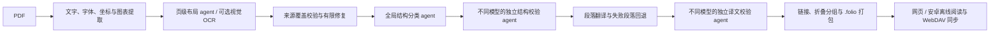

# 架构与自动 Agent 流程（0.3.0）

PC 本地服务接收 PDF，执行结构分析、翻译和独立校验，输出 `.folio` 阅读包。网页/PWA 与安卓 App 消费文献包，阅读时不调用模型。实现采用 Python、FastAPI、PyMuPDF 和浏览器 JavaScript。

每个 agent 只能输出规定的 JSON 决策；PDF、图片、前一模型的建议都是数据。模型没有文件、命令执行或网络工具。原文由程序组合来源块，模型不能改写原文、构造文件路径或丢失来源 ID。

## 结构分析与独立校验

提取器保存来源块、页码、PDF point 坐标、字体和样式。同一个原生 PDF 块中的主标题、小标题及正文按实际行和字号拆分。页级布局 agent 分析分栏、阅读顺序、段落、图注和图表区域；每批携带此前的章节大纲，方法的父章节可以跨页保留。

来源覆盖要求每个提取 ID 恰好出现一次，计入保留内容或明确排除清单。布局输出缺漏、重复、未知 ID、越界坐标会触发修复和有序模型回退。仍失败的页面保留全部文字，使用几何顺序作为候选，继续交给全局结构 agent 和独立校验 agent。

结构分类向模型提供完整大纲、原文、来源坐标与字体证据。它判定正文、方法、参考文献、出版信息和附属内容，修正章节层级及局部阅读顺序。独立模型逐 ID 再检查，可恢复断开的标题，以及跨栏/跨页未结束的段落。程序限制合并为相邻来源，保留双方坐标，禁止合并主章节与第一个子章节。

常见出版提示有确定规则，如 Check for updates。未知期刊的提示由两个不同模型都判为 publisher_notice 后才从阅读正文移除；有分歧时保存为折叠的出版信息。混合块只移除对应的提示来源，保留其余内容。原始 PDF 和提取证据仍随包保存。

方法是科学叙述的一部分，默认展开；方法小节属于 Methods。正文参考文献和方法参考文献汇总到同一折叠区，按原内部次序保存。致谢、作者贡献、经费、数据/代码可用性、在线内容、出版声明、报告表格与补充材料分别打标并默认折叠。点击目录、书签、查找结果会展开其目标分组。

## Provider、重试与独立模型选择

主服务分别配置布局和翻译模型。fallbacks 为有序 provider 数组，每个 provider 有自己的 Base URL、密钥、传输选项及有序模型列表；最多 4 个服务，每服务 4 个模型。网页可自动读取各服务的 /models，逐一测试所选模型并调整回退顺序。

校验 agent 按段落的生成模型选择回退链上的下一种不同模型；即使不同 provider 使用相同模型 ID，也不用于自我校验。混合回退生成的段落分别校验，之后仍按链回退。两项主角色使用不同模型时，另一主角色模型自动作为链尾备用；没有不同模型的准备配置会在提交前被拒绝。自动发现时，若主角色相同且没有备用，设置界面会加入一个不同的文本候选，显示在回退配置中。候选可由用户调整或测试。

网络/超时、408、429 和 5xx 每层默认最多请求 3 次，等待有上限；401、403、404 等直接进入下一层。JSON 截断、字段、ID 覆盖或语义约束失败也会提供具体反馈并修复。默认重试次数可设为 1–5。不同 provider 不复用主服务密钥；同 Base URL 才允许显式勾选复用。

翻译按 ID 分别验收。额外的模型注释不会使有效段落整批作废；缺失、空、重复、未翻译或数值不同的段落单独重试，已经通过的译文保留。独立模型比较完整原文与译文，可返回整段修正；数字、正负号、不等号再次由程序检查。撇号和 prime 统一、词内连字符与负号区分；基因/蛋白标识的语义由独立 agent 检查，重复提及不当成新增统计值。

已有译文在原文、块类型、PDF 哈希、目标语言和术语表一致时复用，并重新经过独立校验。失败译文走相同的重试/回退链。全部配置仍无法得到有效译文时保留原文，记录明确原因。没有可用的独立结构校验模型时任务失败并保留缓存。

提示词完整保存在 paperloom/prompts/：layout.md、ocr.md、structure.md、structure_verify.md、translate.md、translation_verify.md。

## 来源、历史与任务管理

extraction.json 保存来源文字和样式。provenance 保存 PDF 哈希、提示词哈希、来源覆盖及结构/翻译校验完成情况。审计记录阶段、模型、provider 主机、回退层、重试原因、输入哈希及 token 用量；不记录密钥和完整 HTTP 错误正文。缓存包含论文的模型输出，位于本机任务目录。

重排使用来源与原文匹配来保存稳定段落 ID，分段变更建立 block_aliases，供旧书签和进度映射。重新准备保存旧 revision 的 .folio 历史。最终再次验证全部来源 ID 恰好计入一次，之后才打包并校验文件清单与 SHA-256。

准备记录可取消、重试；已停止的取消/失败/中断记录可彻底删除原 PDF、模型缓存和生成文件。删除检查 UUID、目录真实路径和运行状态，拒绝运行中的任务及越出任务根目录的路径。人工编辑界面已移除，旧 /review 和 /crop 路由返回 410，重新准备由自动 agent 完成。

服务采用单进程、两个任务线程；PDF 原生调用集中在一个专用线程，模型调用可并发。原子替换状态文件，重启后未完成任务变为 interrupted。取消会在已发出的请求结束或超时后生效。PC 默认监听本机，对局域网开放需访问令牌。阅读端保留来源页、图表弹窗、双语切换、书签和离线存储，文献信息与自动检查记录默认收起。安卓原生网络和 WebDAV 快照协议沿用 0.2.1，详见 android-webdav.md。
